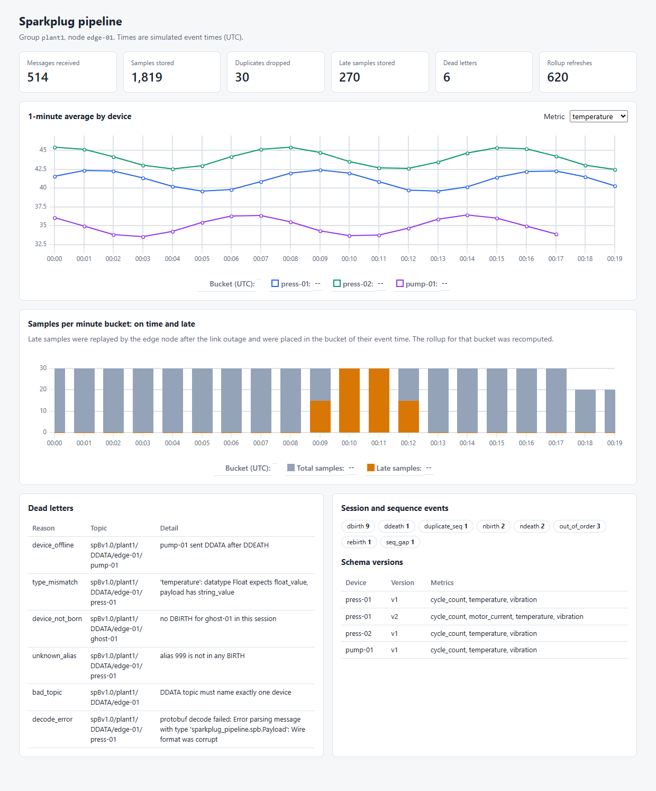
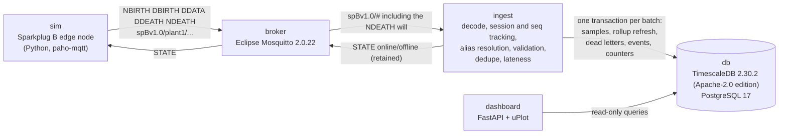

# sparkplug-pipeline

An industrial telemetry pipeline that starts with one `docker compose up`. A
simulated Sparkplug B edge node publishes to an MQTT broker. An ingest service
decodes the messages, tracks each node's session and sequence numbers, resolves
metric aliases, validates and dedupes, and writes to TimescaleDB. A small
dashboard shows the result.

The simulator does not send clean data. It reorders messages, sends a
duplicate, sends five invalid messages, wraps the sequence counter and
rebirths, loses its link, buffers readings and replays them late, and changes
a device's metric set after a firmware update. The integration test checks
that each of those cases ends up where it should in the database.



## Run it

Requires Docker with Compose v2.

```sh
git clone <this repo> sparkplug-pipeline && cd sparkplug-pipeline
docker compose up -d --build
# open http://127.0.0.1:18080 once the sim container has exited (about 5 s)
```

`docker compose down -v` stops the stack and deletes the database volume.

Host ports bind to 127.0.0.1 and avoid the defaults: MQTT on 18830, PostgreSQL
on 15433, dashboard on 18080. Override them with `SPB_MQTT_PORT`,
`SPB_DB_PORT` and `SPB_DASHBOARD_PORT`.

## Architecture



The ingest service acts as the Sparkplug primary host. It subscribes to
`spBv1.0/#` and then publishes a retained `STATE` message with
`{"online": true}`, with an offline will. The edge node waits for that message
before its first BIRTH, so it cannot publish before the subscriber is
listening.

Inside the ingest service, the paho network thread only timestamps each
message and queues it. One worker thread processes messages in arrival order
(sequence tracking depends on that order) and writes them in batches of up to
5,000 rows, or whenever the queue is empty.

## The simulated scenario

One tick is 6 s of simulated event time, so a 1-minute bucket holds 10 ticks.
Event times start at 2026-01-01T00:00:00Z (`SIM_START` overrides it). Group
`plant1`, node `edge-01`, devices `press-01`, `press-02` and `pump-01`, each
with `temperature` (Float), `vibration` (Double) and `cycle_count` (UInt64).
The node has one metric, `store_forward/depth` (UInt32).

| Tick | What the node does | What it tests |
|---|---|---|
| 0 | NBIRTH (bdSeq 0), DBIRTH for each device | alias table, schema v1 |
| 1-94 | one alias-only DDATA per device per tick | normal path |
| 21 | publishes three tick-20 messages after a tick-21 message | seq gap, out-of-order arrival |
| 40 | publishes press-02's DDATA twice | duplicate message |
| 50 | five invalid messages (below) | dead letters |
| 88 | NBIRTH again with the same bdSeq, after seq has wrapped from 255 to 0 | wraparound is not a rebirth; rebirth resets state |
| 95 | drops the link (MQTT v5 DISCONNECT with reason 0x04); the broker publishes the NDEATH will | session end |
| 95-124 | keeps measuring and buffers 30 ticks | store and forward |
| 125 | reconnects with bdSeq 1; press-01 now reports `motor_current`, so every alias after it shifts | schema change, session-scoped aliases |
| 126-134 | live data first | newer buckets fill before old data returns |
| then | replays ticks 92-124 as `is_historical` DDATA, 11 ticks per message | late data; ticks 92-94 were already delivered, so they are duplicates |
| 180 | DDEATH for pump-01, then one stray pump-01 DDATA at 185 | device lifecycle |
| 199 | NDEATH, clean disconnect | |

The five invalid messages at tick 50 are a payload that is not protobuf, a
DDATA topic with no device level, an alias that no BIRTH defined, a DDATA from
a device that never sent DBIRTH, and a string value for a Float metric.

The plan is built by a pure function (`sim/scenario.py`). The simulator
executes it over MQTT, and the integration test builds the same plan to derive
its expectations.

## Data model

| Table | Contents | Key |
|---|---|---|
| `metric_samples` | One row per metric value: event time, value (`value` for numbers and booleans, `value_text` for strings and bytes), datatype, `is_historical` (set by the node), `is_late` (set by ingest), `ingest_time`, bdSeq, seq, schema version. Hypertable with 1-day chunks on event time. | (group, node, device, metric, event_time) |
| `metric_rollup_1m` | Per bucket: sample count, late count, avg, min, max, how often the row was recomputed and when. | (group, node, device, metric, bucket) |
| `dead_letters` | Topic, raw payload bytes, reason code, detail. | id |
| `session_events` | nbirth, rebirth, ndeath, stale_ndeath, dbirth, ddeath, seq_gap, out_of_order, duplicate_seq. | id |
| `device_schemas` | Metric names and datatypes per device, versioned when a BIRTH changes them. | (group, node, device, version) |
| `ingest_counters` | Running totals: messages by type, samples accepted, inserted, duplicate, late, dead letters, rollup refreshes. | name |

Node-level metrics use the empty string as the device. `bdSeq` and
`Node Control/*` metrics are control data and are not stored as samples.

## Late, duplicate and invalid data

**Event time and lateness.** Every row is stored at its event time: the
metric's own timestamp, or the payload timestamp when the metric has none.
Arrival time is kept in `ingest_time`. The ingest service keeps a watermark per
device, the highest event time it has accepted. A row more than 10 s behind the
watermark (`INGEST_ALLOWED_LATENESS_MS`) is flagged `is_late`. The allowance
keeps the reordered messages at tick 21, which are 6 s apart, from counting as
late. The replayed rows are 60 s or more behind and are flagged.

**Rollups for late data.** The rollup table is not a continuous aggregate (see
the next section). After each sample insert, in the same transaction, the
ingest service calls `refresh_rollup_1m` with the buckets that the inserted
rows fall in, computed from their event times. The function recomputes those
rows from `metric_samples` instead of adding to them. A late row therefore
updates the bucket of its event time, a duplicate that inserted nothing
triggers no refresh, and running the same input twice converges on the same
rollup. In the scenario, the minute-9 and minute-12 buckets are computed from
live rows first and recomputed when the replay arrives (5 live and 5 late rows
each); minutes 10 and 11 hold only late rows.

**Duplicates.** The primary key of `metric_samples` is the dedupe key. Inserts
use `ON CONFLICT DO NOTHING`, and each batch is deduped in memory first, so the
first write wins and replays are idempotent. The integration test runs the
whole scenario a second time and checks that no sample or rollup row changes.
Duplicate messages are still processed: the seq tracker records a
`duplicate_seq` event, and the rows are dropped by the key. This also covers
store-and-forward overlap, where the node resends readings it cannot confirm
were delivered.

**Sequence numbers.** Each node message after NBIRTH carries seq 0-255,
wrapping. The tracker classifies each one as in order, a gap (ahead by up to
127; the skipped numbers are remembered), out of order (behind and among the
remembered missing numbers), or a duplicate (behind and not missing). Anomalies
become `session_events`; the data is kept because every metric carries its own
timestamp. NBIRTH must carry seq 0 and resets the tracker. An NBIRTH with the
same bdSeq as the live session is recorded as a rebirth.

**Aliases.** The alias table is built from NBIRTH and DBIRTH and replaced by
every NBIRTH. In the scenario, aliases shift after the reconnect because
press-01 gained a metric, so data decoded with the old table would land under
the wrong names. The integration test compares every stored value with the
plan, which would catch that.

**Invalid data.** A message that fails any check goes to `dead_letters` whole,
with its raw bytes, so it can be replayed after a fix. Rejecting the whole
message keeps a DDATA from being half-stored. A rejected BIRTH changes no state.
Reason codes: `bad_topic`, `decode_error`, `no_session` (data with no live
NBIRTH), `missing_seq`, `invalid_birth`, `alias_conflict`, `device_not_born`,
`device_offline` (after DDEATH), `unknown_alias`, `unknown_metric`,
`alias_mismatch`, `type_mismatch`, `out_of_range`, `missing_value`,
`unsupported_type`, `missing_timestamp`, `future_timestamp` (more than 5
minutes ahead of arrival).

**Schema versions.** When a BIRTH's set of (metric name, datatype) differs from
the device's latest version, a new version is written and new rows carry it.
Rows written under the old schema keep their version. Versions are loaded from
the database at startup, so numbering survives restarts.

## Why there is no continuous aggregate

The stack uses `timescale/timescaledb:2.30.2-pg17-oss`, the Apache-2.0 edition.
That edition provides hypertables and `time_bucket`; continuous aggregates are
under the Timescale License. Creating one on this image fails:

```
ERROR:  functionality not supported under the current "apache" license.
```

`SHOW timescaledb.license` returns `apache`. The rollup table plus
`refresh_rollup_1m` does the work a continuous aggregate would do here. It
recomputes exactly the buckets that changed, which is the idea behind a
continuous aggregate's invalidation log, but it runs synchronously.

## Sparkplug B encoding

`proto/sparkplug_b.proto` was written for this project from the payload
structure documented in the Sparkplug B v3.0.0 specification. Message and field
names and field numbers are interface facts taken from the specification text.
No file from Eclipse Tahu (EPL-2.0) or any other implementation was copied or
consulted. The file models the payload header, metrics with scalar values,
metadata and property sets. DataSet, Template and extension values are not
modeled and are dead-lettered.

`src/sparkplug_pipeline/sparkplug/sparkplug_b_pb2.py` is generated and
committed with a header naming the command:

```sh
uv run --no-project --with grpcio-tools==1.84.0 scripts/gen_proto.py          # regenerate
uv run --no-project --with grpcio-tools==1.84.0 scripts/gen_proto.py --check  # CI check
```

Signed integers travel in unsigned fields as two's complement. Writers differ
on whether Int8 -1 is sent as `0xFF` or `0xFFFFFFFF`; the decoder accepts both.

## Tests

```sh
uv run pytest                      # 77 unit tests, no Docker needed
uv run pytest -m integration       # builds and starts the stack, runs the scenario, tears it down
```

Unit tests cover the protobuf wire format, value decoding, topic parsing, seq
tracking (gaps, reordering, duplicates, wraparound), alias resolution and its
session scope, every dead-letter path, the lateness watermark, bucket placement
by event time, batch dedupe, schema versioning, the readiness-file path
check and the compose command allowlist.

The integration test starts the compose stack, waits for the simulator to
exit, and checks that:

- every published message and the broker's will were received (513);
- stored rows equal the plan's unique readings, value by value (1,819);
- 30 duplicate readings were dropped;
- the six dead letters have the planned reasons and the original bytes;
- exactly the 270 replayed readings are flagged late, and they span ticks 95-124;
- every rollup row equals an aggregate computed in Python from the plan, and
  the buckets that got late rows were recomputed;
- session events and schema versions match the plan;
- a second full run of the simulator changes no sample or rollup row.

`SPB_COMPOSE` picks the compose command from a fixed list: `docker` (the
default, `docker compose`), `docker-compose`, or `wsl` (`wsl -e docker
compose`, for a Windows host whose Docker engine runs in the default WSL
distribution). Any other value stops the test before it runs a command.

```powershell
$env:SPB_COMPOSE = 'wsl'; uv run pytest -m integration
```

CI (`.github/workflows/ci.yml`) runs lint, the generated-code check and the
unit tests, then the integration test on `ubuntu-24.04`. Actions are pinned to
commit SHAs.

## Measured numbers

All numbers come from runs on one machine: Intel Core i9-11900H (8 cores, 16
threads), Windows 11, Docker Engine 29.1.3 in WSL2 (Ubuntu), 16 GB visible to
WSL.

**Scenario run** (`docker compose up`, counters from `ingest_counters`): 514
messages received, one of them the ingest service's own retained STATE
message; 1,849 readings accepted, 1,819 rows inserted, 30 duplicates dropped,
270 late rows inserted, 6 dead letters, 620 rollup row recomputations. Two
integration test runs took 25.4 s and 34.1 s, including the image build and
stack start.

**Throughput** (`uv run scripts/benchmark.py --messages 20000 --run N`). The
script publishes an NBIRTH, a DBIRTH and 20,000 DDATA messages (one device,
three metrics each, 1 s apart in event time) at QoS 0 from the Windows host to
the broker's published port. The clock starts at the first DDATA and stops
when `ingest_counters` shows all messages committed, so the figure includes
decode, validation, dedupe, the insert and the rollup refresh. Four runs:

| Run | Messages/s | Rows/s |
|---|---|---|
| 1 | 3,242 | 9,725 |
| 2 | 4,675 | 14,024 |
| 3 | 3,959 | 11,878 |
| 4 | 4,451 | 13,354 |

Median 4,205 messages/s. In run 1 the publisher offered about 17,700
messages/s, so the ingest service was the bottleneck. Every run reached the
full message count.

## Configuration

| Variable | Service | Default |
|---|---|---|
| `MQTT_HOST`, `MQTT_PORT` | ingest, sim | `localhost`, `1883` |
| `DB_HOST`, `DB_PORT`, `DB_NAME`, `DB_USER`, `DB_PASSWORD` | ingest, dashboard | compose sets demo values |
| `SPARKPLUG_HOST_ID` | ingest, sim | `ingest-01` |
| `INGEST_ALLOWED_LATENESS_MS` | ingest | `10000` |
| `INGEST_MAX_FUTURE_MS` | ingest | `300000` |
| `INGEST_BATCH_MAX`, `INGEST_FLUSH_MS` | ingest | `5000`, `200` |
| `INGEST_READY_FILE` | ingest | `ingest-ready` under the temp directory; paths outside it are refused at startup |
| `SIM_START`, `SIM_DELAY_MS` | sim | `2026-01-01T00:00:00+00:00`, `2` |

## Limitations

- Session state (aliases, seq tracker, watermarks) is held in memory. After an
  ingest restart, data is dead-lettered as `no_session` until the node sends a
  new NBIRTH. A full host application would send a Rebirth NCMD; this one does
  not send commands.
- No reorder buffer. Out-of-order messages are stored as they arrive and
  reported as events; lateness only sets a flag.
- First write wins. A second reading with the same key but a different value
  is counted as a duplicate, not flagged as a conflict.
- A seq gap of 128 or more is read as an old message, because the 0-255
  counter cannot tell the two apart.
- The rollup refresh runs inside the ingest transaction. Its cost grows with
  the number of rows per bucket and the number of buckets per batch. At higher
  volume, a queue of invalidated buckets refreshed out of band would decouple
  it from ingest.
- Rollups aggregate numeric values only (booleans as 0 and 1).
- MQTT uses QoS 0 for data, as Sparkplug specifies, and a clean session.
  Messages published while the ingest service is disconnected are lost.
- A database error other than a lost connection stops the ingest service;
  compose restarts it, with the in-memory state loss described above.
- The benchmark uses one node and one device, with the publisher on the same
  machine. It does not measure fan-in from many nodes.
- The `messages_received` counter includes the retained STATE message.
- The broker allows anonymous connections, there is no TLS, and the database
  password is a fixed demo value. Ports bind to 127.0.0.1 only.
- DataSet, Template, array and extension metric values are not stored.

## Dependencies

No package in the Python environment, no library on the dashboard page and no
component this project adds to its images is under GPL, LGPL or AGPL. Licenses
were read from installed package metadata with `pip-licenses` and from each
project's license file.

Python runtime (from `uv.lock`):

| Package | Version | License |
|---|---|---|
| protobuf | 7.36.2 | BSD-3-Clause |
| paho-mqtt | 2.1.0 | EPL-2.0 OR EDL-1.0; used under EDL-1.0 (BSD-3-Clause text) |
| pg8000 | 1.31.5 | BSD-3-Clause |
| scramp (via pg8000) | 1.4.17 | MIT-0 |
| asn1crypto (via scramp) | 1.5.1 | MIT |
| python-dateutil (via pg8000) | 2.9.0.post0 | Apache-2.0 OR BSD-3-Clause |
| six (via python-dateutil) | 1.17.0 | MIT |
| fastapi | 0.143.0 | MIT |
| starlette | 1.8.0 | BSD-3-Clause |
| pydantic | 2.14.1 | MIT |
| pydantic_core | 2.50.1 | MIT |
| annotated-types | 0.8.0 | MIT |
| annotated-doc | 0.0.5 | MIT |
| typing-inspection | 0.4.4 | MIT |
| typing_extensions | 4.16.0 | PSF-2.0 |
| anyio | 4.15.1 | MIT |
| idna | 3.20 | BSD-3-Clause |
| opentelemetry-api (via fastapi) | 1.45.1 | Apache-2.0 |
| uvicorn | 0.54.0 | BSD-3-Clause |
| h11 | 0.16.0 | MIT |
| click | 8.5.0 | BSD-3-Clause |

Development and tooling (not in the images):

| Package | License |
|---|---|
| pytest 9.1.1, pluggy 1.6.0, iniconfig 2.3.1 | MIT |
| Pygments 2.21.0 | BSD-2-Clause |
| packaging 26.3 | Apache-2.0 OR BSD-2-Clause |
| colorama 0.4.6 | BSD-3-Clause |
| ruff 0.17.0 | MIT |
| hatchling (build backend) | MIT |
| grpcio-tools 1.84.0, grpcio (code generation only) | Apache-2.0 |
| playwright 1.55.0 (screenshot only) | Apache-2.0 |
| uv | MIT OR Apache-2.0 |

Dashboard page: uPlot 1.6.32, MIT, loaded from jsDelivr with a pinned version
and subresource integrity hashes.

Container images:

| Image | Software license |
|---|---|
| `timescale/timescaledb:2.30.2-pg17-oss` | TimescaleDB Apache-2.0 edition; PostgreSQL License |
| `eclipse-mosquitto:2.0.22` | EPL-2.0 OR EDL-1.0; used under EDL-1.0 |
| `python:3.12-slim-bookworm` | PSF-2.0 for CPython |
| `ghcr.io/astral-sh/uv:0.11.26` (build stage, uv binary only) | MIT OR Apache-2.0 |

The base images also contain operating system packages from Debian and Alpine,
some of them GPL-licensed (for example bash, coreutils and BusyBox). The
project does not modify or link against them and uses the public images as
published.

## License

Apache-2.0. See [LICENSE](LICENSE). Copyright 2026 John Hall.
